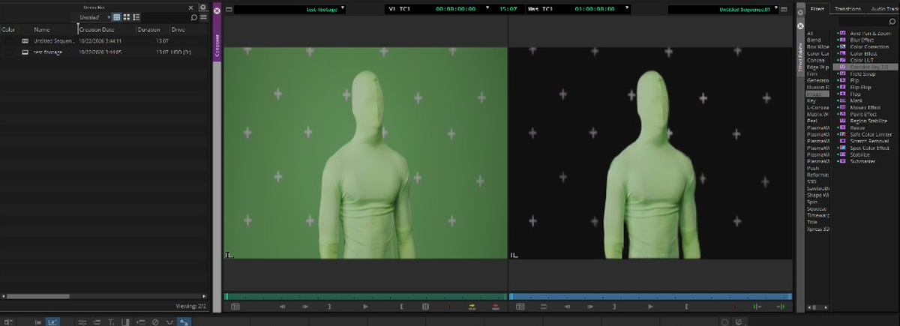
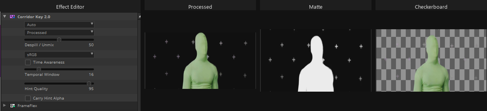

# Corridor Key 2.0 for Avid Media Composer
[](https://buymeacoffee.com/ber2minsin)

Community AVX2 plugin that runs [Corridor Key 2.0](https://github.com/nikopueringer/CorridorKey2.0) inside **Avid Media Composer** for AI green/blue screen keying.

Product overview: [corridorkey.com](https://corridorkey.com/)

This project is not affiliated with Avid or Corridor Digital.


---

## Requirements

- Windows 10 (22H2+) or Windows 11
- **NVIDIA** GPU with a current Game Ready / Studio driver ([download](https://www.nvidia.com/Download/index.aspx))
- **Avid Media Composer** (Standard, Ultimate, or equivalent — not Media Composer First)
- Internet access during Setup (or first use) to download model weights and CUDA PyTorch

Editors do not need a separate Python install. The Setup wizard bundles a small Python runtime and fetches Corridor Key assets with the official upstream download script.

Approximate VRAM: about 4 GB up to 1440p, about 6 GB for 4K (same guidance as Corridor Key 2.0).

---

## Install

1. Install and activate Media Composer; complete its first launch.
2. Install a current NVIDIA driver; reboot if Windows requests it.
3. Run **`Setup-CorridorKey-2.0.exe`** (release asset, or built under `packaging\dist\`).
4. Approve UAC. On the tasks page, leave **Download Corridor Key 2.0 models and CUDA PyTorch** checked (recommended, about 6–8 GB).
5. Finish the wizard. Fully quit Media Composer if it was open, then start it again.

Uninstall from **Settings → Apps → Corridor Key 2.0**.

If you skipped the download task, the worker will attempt the same official `download_weights.py` path on first effect use (network required).

---

## Use in Media Composer



1. Place a green or blue screen clip on the timeline.
2. Open **Tools → Effect Palette** (`Ctrl+8`).
3. Category **Image** → drag **Corridor Key 2.0** onto the clip.
4. Open **Effect Editor**.



### Controls

| Control | Description |
|--------|-------------|
| **Mode** | **Auto** — one-click key with no hint. **External Hint (FG alpha)** — use this clip’s alpha channel as an Alpha Hint when it is not flat opaque. |
| **Output** | Processed, Matte, Foreground, or Checkerboard |
| **Despill / Unmix** | Spill removal strength (0–100%) |
| **Colorspace** | sRGB or Linear |
| **Time Awareness** | Analyze the clip for temporal consistency (slower first pass; reduces flicker) |
| **Temporal Window** | Frames per temporal window when Time Awareness is on (1–80) |
| **Hint Quality** | How strongly to trust the Alpha Hint (0–100%) |
| **Carry Hint Alpha** | Carry hint across temporal windows |

The first frame after apply may take up to about a minute while the model loads on the GPU. That is expected.

If the effect is missing from the palette: quit Media Composer, confirm Setup completed, restart Media Composer, and re-apply the effect (remove any older Corridor Key instance from the clip first).

Logs: `%LOCALAPPDATA%\CorridorKeyAVX\logs\`

---

## Alpha Hint

Media Composer delivers flat black video if this effect declares a second input, even when that input is optional. Alpha Hint is therefore **not** a second Effect Palette track.

To guide the key:

1. Put your B&W guide matte into the **alpha channel** of the clip (or a nest) you are keying.
2. Set **Mode** to **External Hint (FG alpha)**.
3. If alpha is flat opaque, the plugin stays in Auto and does not pass a hint to the model.

---

## Build from source (developers)

You need:

- [AVX2 Connectivity Toolkit](https://www.avid.com/alliance-partner-program/avx-connectivity-toolkit) as `AVX2SDK` (gitignored)
- Visual Studio 2022 (C++), CMake
- [Inno Setup 6](https://jrsoftware.org/isinfo.php) (`winget install JRSoftware.InnoSetup`)
- Git, with the **CorridorKey2.0** submodule initialized

```powershell
git clone --recurse-submodules https://github.com/ber2minsin/corridor-key-v2-avid.git
# or after clone:
git submodule update --init --recursive

scripts\sync_corridorkey.ps1          # optional: refresh weights via upstream script
scripts\build_plugin.ps1
scripts\build_installer.ps1           # slim Setup EXE; models download at install time
scripts\run_all_tests.ps1
```

| Script | Purpose |
|--------|---------|
| `scripts\sync_corridorkey.ps1` | `git submodule update` + official `download_weights.py` |
| `scripts\sync_corridorkey.ps1 -Remote` | Move submodule to latest `origin/master`, then download weights |
| `scripts\build_plugin.ps1` | Build `CorridorKey.avx` |
| `scripts\build_installer.ps1` | Bundle slim payload and compile `Setup-CorridorKey-2.0.exe` |
| `scripts\deploy_plugin.ps1` | Copy built `.avx` into Avid folders (admin; MC must be quit) |
| `packaging\post_install.ps1` | Same download/pip steps the Setup wizard runs |

Corridor Key 2.0 is tracked as submodule `CorridorKey2.0` → [nikopueringer/CorridorKey2.0](https://github.com/nikopueringer/CorridorKey2.0). Weights are **not** vendored; they are fetched with `CorridorKey2.0/scripts/download_weights.py` (Hugging Face + foundation models).

Installer output: `packaging\dist\Setup-CorridorKey-2.0.exe` (slim; not a multi-GB offline bundle).

---

## License and credits

See [LICENSE](LICENSE).

Corridor Key 2.0 engine and weights remain under Corridor Digital’s terms ([upstream](https://github.com/nikopueringer/CorridorKey2.0)). Avid and Media Composer are trademarks of Avid Technology, Inc.
